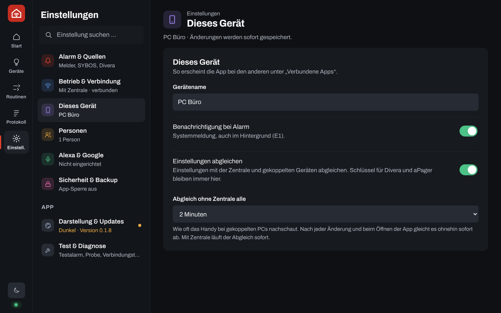
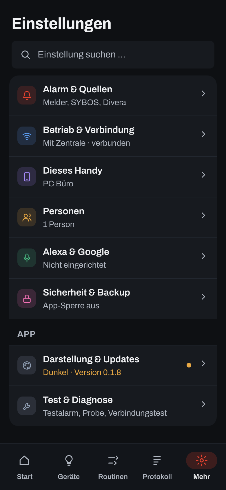

<p align="center"></p>

<h1 align="center">Heimalarm</h1>
<p align="center">Einsatz-Alarme zuhause weitergeben.</p>

---

## Was ist Heimalarm?

Heimalarm ist für Einsatzkräfte, die zuhause alarmiert werden – egal ob Feuerwehr, Rettungsdienst, Wasserwacht oder Katastrophenschutz. Wenn der Alarm kommt, reagiert das Zuhause mit:

- **PC:** Ein Vollbild fragt „Fährst du?“ – auf jedem Bildschirm, mit Ton in einstellbarer Lautstärke. Danach geht der PC in den Ruhezustand – offene Programme bleiben erhalten.
- **Handy:** Alarm groß – auch auf dem Sperrbildschirm – mit Stichwort und Adresse, auf Wunsch eigener Alarmton, Rückmeldung mit einem Tipp.
- **Licht & Sprachassistenten:** Nachts geht das Flurlicht gedimmt an, Alexa oder Google sagen „Einsatz!“ an.

Alles läuft lokal im Heimnetz und ohne laufende Kosten. Cloud-Dienste (Divera, aPager-Rückmeldung, Voice Monkey) nutzt Heimalarm nur, wenn du sie selbst einschaltest. Melder und Alarm-App bleiben die eigentliche Alarmierung – Heimalarm ist eine Komfortfunktion.

<p align="center">
  
  
</p>

Oben auf **Start** steht immer, ob Heimalarm bereit ist: **Aktiv**, **Verbindet** (prüft gerade Zentrale, Melder, PCs, Divera) oder – je nach **Bereitschaft** – **Nicht verfügbar** bzw. **Abwesend** (verbunden, aber bei Alarm passiert nichts; endet zur gewählten Zeit von selbst und springt auf **Verfügbar** zurück). PC und Handy zeigen dieselben Teile, am Handy untereinander.

## So funktioniert es

Heimalarm läuft auf zwei Arten – du wählst in der App unter *Einstellungen → Betrieb & Koppeln*.

### Welcher Aufbau passt?

| Du hast … | Dann |
|---|---|
| nur Handy und PC, Alarm kommt über SYBOS, aPager oder Divera | **Ohne Zentrale** – nichts weiter nötig |
| ein Gerät, das immer läuft (z. B. **UGREEN-NAS**, Synology, Raspberry Pi, Heimserver) | **Mit Zentrale** – dazu der Melder in der Ladeschale |
| einen Melder in der Ladeschale | **Mit Zentrale** + **ESP32** am Relaiskontakt (ca. 10 €) |

Die **Zentrale** ist kein bestimmtes Gerät, sondern ein kleines Docker-Projekt (`zentrale/`). Es läuft überall, wo Docker läuft – ein Raspberry Pi ist **nicht** nötig. Anleitung für die UGREEN-NAS: [docs/Einrichtung-NAS.md](docs/Einrichtung-NAS.md).

**Mit Zentrale (NAS oder Raspberry Pi)** – alles läuft auch, wenn PC und Handy aus sind.

<p align="center"></p>

**Ohne Zentrale** – Handy und PC arbeiten direkt zusammen. Ideal, wenn du nur auf SYBOS, aPager oder Divera wartest.

<p align="center"></p>

| | Mit Zentrale | Ohne Zentrale |
|---|---|---|
| PC herunterfahren | ✅ | ✅ Handy meldet an den PC, Divera fragt der PC selbst ab |
| Melder in der Ladeschale (ESP32) | ✅ | – |
| WLAN-Lampen & Steckdosen | ✅ | ✅ Handy schaltet direkt |
| Zigbee-Lampen | ✅ | nur über eine Hue Bridge |
| Alexa | ✅ Matter (lokal) oder Voice Monkey | ✅ Voice Monkey |
| Google Home | ✅ Matter (lokal) | – |
| Matter-Geräte aus Alexa, Google & Co. steuern | ✅ Matter (lokal) | – |
| Routinen | ✅ laufen auf der Zentrale | ✅ laufen auf dem Handy |
| Läuft, wenn Handy aus oder unterwegs | ✅ | – |

## Funktionen

| | |
|---|---|
| **Alarmquellen** | Melder (ESP32), SYBOS, aPager PRO, Divera 24/7 – auch mehrere gleichzeitig. Doppelte Meldungen werden zu einem Einsatz. |
| **„Fährst du?“ am PC** | Vollbild auf allen Bildschirmen mit Countdown. Danach Ruhezustand, Sperren, Herunterfahren oder nichts. Ausnahmen (z. B. bei laufendem OBS), Ruhezeiten, Medien stoppen. |
| **Alarmton** | Melder-Ton oder eigener Ton (MP3, WAV, OGG, FLAC) auf PC und Handy. „Ton testen“ zeigt, wie laut es wird; am PC hebt Heimalarm auf Wunsch die Windows-Lautstärke an, am Handy klingelt es als Wecker – auch im Lautlos-Modus. |
| **Alarm am Handy** | Vollbild über dem Sperrbildschirm mit Vibration und „Ich fahre / nicht“. Startet nach einem Neustart des Handys von selbst. |
| **Rückmeldung** | „Ich fahre / nicht“ geht an Divera (Rückmeldung und Status) und aPager (Zu-/Absage). |
| **Divera-Status** | Eigenen Status auf Start mit einem Tipp setzen, optional automatisch zurücksetzen. |
| **Licht & Geräte** | WLAN-Geräte (Shelly, Hue, WLED, Tasmota) und Heizkörperthermostate direkt im Heimnetz, mit Zentrale auch Zigbee und Matter – ohne Hersteller-Cloud. |
| **Ohne Zentrale** | Handy und PC koppeln sich mit einem Code im WLAN. Das Handy meldet Alarme an den PC und führt die Routinen aus. |
| **Routinen** | Wenn Alarm, Uhrzeit oder Gerät → Licht, Gruppen, Verzögerung, „Wieder da“. Bedingungen wie Nacht, dunkel, Wochentag, Stichwort. Pro Person. |
| **Alexa & Google Home** | Alarm startet Routinen (Ansage, Licht). Lokal über Matter (mit Zentrale) oder Alexa über Voice Monkey (auch ohne). |
| **Mehrere Personen** | Jede Person mit eigener Kennung, eigenen Routinen und eigenem Melder. |
| **Start** | Status Aktiv / Verbindet / Inaktiv mit Verbindungs-Check, Kennzahlen, Licht zum Schalten, Schnellaktionen, „Zuletzt“. Zeigt nur, was eingerichtet ist. |
| **Einsatz-Logbuch** | Jeder Einsatz mit allen Infos, Notizen, Statistik und Jahresrückblick, CSV-Export. |
| **Test & Diagnose** | Testalarm, Melder-Alarm nachspielen, Generalprobe, Verbindungstest, automatischer Selbsttest (Tage und Uhrzeit einstellbar, abschaltbar) – was jeder Test wirklich auslöst, steht in der App unter *Test & Diagnose*. |
| **Am PC (optional)** | Discord-Status bei Einsatz, Tasten vor dem Ruhezustand (z. B. Speichern in einem Programm). Unter *Einstellungen → Vor dem Ruhezustand* bzw. *Discord*. |
| **Home Assistant** | Mit Zentrale erscheint Heimalarm von selbst in Home Assistant (MQTT). Unter *Einstellungen → Alexa, Google & HA*. |
| **Sicher & privat** | Alles im Heimnetz. App-PIN, Admin-PIN, API-Schlüssel bleiben auf dem Gerät. |
| **Bedienung** | Dunkel (Standard) und hell, jeder Bereich mit eigener Farbe. Einstellungen, Geräte, Routinen und Protokoll in zwei Spalten (am Handy Liste → Unterseite). Einstellungen gleichen sich ab. |

## Kompatible Geräte

| Gerät | Ohne Zentrale | Mit Zentrale | Hinweis |
|---|---|---|---|
| **Shelly** (Schalter, Stecker, Dimmer) | ✅ | ✅ | direkt im WLAN, Gen1 bis Gen3 |
| **Philips Hue** | ✅ | ✅ | über die Hue Bridge; Knopf drücken zum Koppeln |
| **IKEA** (Tradfri, Dirigera-Lampen) | ✅ über Hue Bridge | ✅ | mit Zentrale direkt per Zigbee-Stick |
| **WLED** (LED-Streifen) | ✅ | ✅ | |
| **Tasmota** | ✅ | ✅ | umgeflashte Stecker und Lampen |
| **Tuya / Smart Life** | über Alexa-Routine | ✅ Zigbee-Geräte | WLAN-Geräte nur über die Tuya-Cloud – per Voice Monkey eine Alexa-Routine starten, die sie schaltet |
| **FRITZ! Heizkörperregler** (FRITZ!Smart Thermo 301/302, FRITZ!DECT 301/302, Comet DECT) | ✅ | ✅ | über die FRITZ!Box; eigenen FRITZ!Box-Benutzer mit Recht „Smart Home“ anlegen |
| **Shelly BLU TRV** | ✅ | ✅ | über das Shelly BLU Gateway Gen3 |
| **Zigbee-Thermostate** (z. B. Sonoff TRVZB, TRV Gen2, Bosch, Aqara E1) | – | ✅ | über Zigbee2MQTT, braucht Zigbee-Stick |
| **Matter-Thermostate** (z. B. Eve Thermo, tado X) | – | ✅ Matter | erst in Alexa/Google/Apple einrichten, dann teilen; Thread braucht einen Thread-Router |
| **Zigbee allgemein** | – | ✅ | tausende Geräte, siehe [Zigbee2MQTT](https://www.zigbee2mqtt.io/supported-devices/) |
| **Amazon Echo** | ✅ Voice Monkey | ✅ Matter oder Voice Monkey | Echo mit Matter für den lokalen Weg |
| **Google Nest / Home** | – | ✅ Matter | Nest Hub, Nest Lautsprecher oder Google TV |

**Heizung in Routinen:** Aktion „+ Heizung“ stellt ein Thermostat auf eine Temperatur oder aus (Frostschutz), z. B. bei Alarm auf 16 °C. Mit Zentrale bringt „Wieder da“ die vorherige Temperatur zurück.

**Voice Monkey** ([voicemonkey.io](https://voicemonkey.io)) startet Alexa-Routinen per Internet. In Voice Monkey einen „Routine Trigger“ anlegen, in der Alexa-App eine Routine damit starten (z. B. Ansage „Einsatz!“, Licht an) und in Heimalarm den API-Token eintragen. In Routinen als Aktion „+ Alexa“.

## Anleitungen als PDF

Zum Herunterladen und Durchlesen – ohne Vorwissen, Schritt für Schritt:

| PDF | Inhalt |
|---|---|
| [**Heimalarm im Überblick**](docs/anleitungen/Heimalarm-Uebersicht.pdf) | Was die App kann, Bausteine, Ablauf eines Alarms, Funktionen, Grenzen – ohne Technik-Deutsch |
| [**Einrichtung: ESP32 + UGREEN NAS oder Raspberry Pi**](docs/anleitungen/Heimalarm-Einrichtung-ESP32.pdf) | Ladeschale prüfen und verdrahten, Zentrale auf NAS oder Pi, Firmware am PC oder auf der Zentrale bauen, Kontakt-Test |
| [**Heimalarm aktualisieren**](docs/anleitungen/Heimalarm-Update.pdf) | Apps, Zentrale auf NAS oder Pi und ESP32 auf den neuen Stand bringen, mit den typischen Stolpersteinen der UGREEN-NAS |

Auf GitHub die Datei öffnen und oben rechts auf **Download** klicken. Die Quellen liegen in `docs/anleitungen/quelle` (HTML), neu bauen mit `python3 docs/anleitungen/quelle/build.py`.

<p align="center">
  
  
</p>

## Installation & Einrichtung

**Was du brauchst:** Heimalarm auf PC (Windows) und/oder Handy (Android). Optional eine Zentrale (NAS, Raspberry Pi oder anderer Rechner mit Docker) und einen ESP32 für den Melder.

Die App führt dich selbst durch: **Start** zeigt eine Checkliste und das Schaubild deines Aufbaus, bis alles eingerichtet ist.

**1 · App installieren**
Installer (`.exe`) bzw. APK aus den [Releases](../../releases) laden und installieren.

**2 · Betrieb wählen**
*Einstellungen → Betrieb & Koppeln:* „Mit Zentrale“ oder „Ohne Zentrale“. Ohne Zentrale am PC Adresse und Code ablesen und am Handy unter „PC hinzufügen“ eintragen. Windows fragt einmal nach der Firewall – „Private Netzwerke“ erlauben.

**Mehrere PCs und Laptops:** Mit Zentrale auf jedem Gerät Heimalarm installieren, mit der Zentrale verbinden und **dieselbe Kennung** eintragen – alle zeigen bei Alarm „Fährst du?“, egal ob der Melder oder SYBOS/aPager/Divera am Handy auslöst. Ohne Zentrale jeden PC am Handy unter „PC hinzufügen“ eintragen. Für einen gemeinsamen PC mehrerer Personen: *Einstellungen → „Fährst du?“ → „Auch bei Alarm von“*.

**3 · Alarmquellen wählen**
In der App unter *Einstellungen → Alarmquellen* einschalten, was du nutzt:
- **SYBOS / aPager / Divera:** Am Handy „Benachrichtigungen mitlesen“ erlauben. Für Divera bzw. aPager optional den persönlichen API-Schlüssel eintragen – dann klappt auch die Rückmeldung.
- **Melder:** braucht Zentrale und ESP32 (Schritt 5 und 6).

**4 · Licht & Alexa**
Unter *Geräte → WLAN-Gerät* Lampen und Steckdosen hinzufügen, unter *Einstellungen → Alexa, Google & HA* den Voice-Monkey-Token eintragen. Dann unter *Routinen* „Vorlage“ antippen – die Routine öffnet sich rechts (am Handy als eigene Seite) zum Bearbeiten.

**5 · Zentrale (optional)** – NAS oder Raspberry Pi mit Docker

Auf einer NAS mit Docker-Oberfläche (z. B. UGREEN, Synology) den Ordner `zentrale` hochladen und als Projekt starten – Schritt für Schritt in [docs/Einrichtung-NAS.md](docs/Einrichtung-NAS.md). Mit Kommandozeile:
```bash
cd zentrale
cp .env.example .env                                     # MQTT_PASSWORD setzen – Pflicht
docker compose up -d                                     # Grundausstattung
docker compose --profile zigbee up -d                    # mit Zigbee-USB-Stick
docker compose --profile zigbee --profile matter up -d   # dazu Licht für Alexa / Google
```
Dann der Zentrale im Router eine feste IP geben und sie in der App unter *Einstellungen → Zentrale* eintragen (Port `9001`, Benutzer und Passwort aus `.env`). Ohne Passwort startet die Zentrale nicht – sonst könnte jeder im WLAN Fehlalarme senden.

**6 · ESP32 (optional)**
1. `esp32/secrets.example.yaml` nach `secrets.yaml` kopieren, WLAN-Daten und als `mqtt_host` die IP der Zentrale eintragen. Bei `mqtt_pw` **dasselbe Passwort wie `MQTT_PASSWORD` in `zentrale/.env`**. In der YAML-Datei die `kennung` setzen – dieselbe wie in der App (siehe „Kennung“ unten).
2. Kontakt der Ladeschale messen (keine Spannung, bei Alarm Durchgang). Die Ladeschale hat eine Steckklemme: ein 2-adriges Kabel einstecken, am anderen Ende per WAGO-Klemme mit zwei Jumper-Kabeln verbinden (keine Litze direkt in die Jumper-Buchse). Einen Pol an `GPIO27`, den anderen an `GND`.
3. `esp32/alarm-ich.yaml` flashen – am Windows-PC mit `pip install esphome` und `esphome run alarm-ich.yaml` (Anleitung: [ESP32-PDF](docs/anleitungen/Heimalarm-Einrichtung-ESP32.pdf), Schritt 4B) oder mit der ESPHome-Oberfläche der Zentrale. Für ein **ESP32-S3**-Board stattdessen `esp32/alarm-ich-s3.yaml` (Pol A an `GPIO4`, direkt neben `RST` – genau zählen), für einen **Wemos D1 mini (ESP8266)** `esp32/alarm-ich-d1mini.yaml` (Pol A an `D5`).
4. In der App unter *Test & Diagnose → Kontakt-Test* die Kabel prüfen: Die Anzeige springt beim Verbinden auf „geschlossen“, ein Alarm wird dabei nicht ausgelöst. Öffnet der Kontakt deiner Ladeschale bei Alarm, statt zu schließen: *Einstellungen → Melder (ESP32) → „Alarm, wenn der Kontakt“ → öffnet*.

**Kennung**
Ein kurzer Name pro Person, z. B. `daniel` – nur Kleinbuchstaben, Ziffern und `-`. Jede Person braucht eine **eigene**; bleibt überall der Standard `ich` stehen, lösen sich mehrere Personen gegenseitig aus. Dieselbe Kennung gehört in die App (*Einstellungen → Kennung & Sperrzeit*, auf jedem eigenen Gerät), in den ESP32 (`kennung:`) und unter *Einstellungen → Personen*.

**7 · Testen**
Auf *Start* **Testalarm** – es passiert nichts Echtes, du siehst nur die Abfrage. Unter *Einstellungen → „Fährst du?“* bzw. *Handy bei Alarm* mit **Ton testen** prüfen, wie laut es wird. Mehr unter *Einstellungen → Test & Diagnose*.

**Updates**
Heimalarm sucht beim Start und danach alle 6 Stunden auf GitHub nach einer neuen Version (*Einstellungen → Darstellung & Updates*, abschaltbar). Mit **Installieren** lädt die App die Datei, prüft die Prüfsumme und installiert – am PC still mit Neustart, am Handy über den normalen Android-Installationsdialog (beim ersten Mal „Apps aus dieser Quelle zulassen“). Einstellungen bleiben erhalten. 

Ausführlich mit Bildern: [Heimalarm im Überblick (PDF)](docs/anleitungen/Heimalarm-Uebersicht.pdf)

---

<sub>Ergänzt die Alarmierung, ersetzt sie nicht. Melder und Alarm-App bleiben maßgeblich.</sub>
