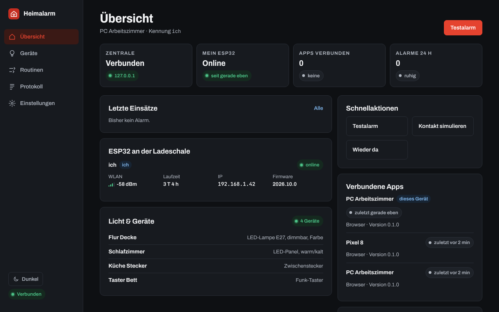
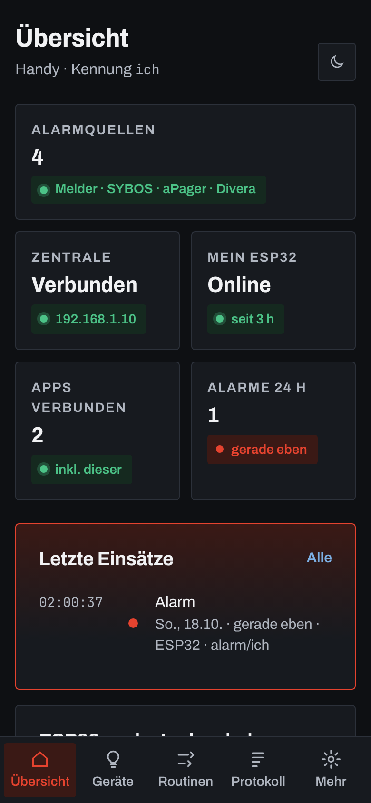
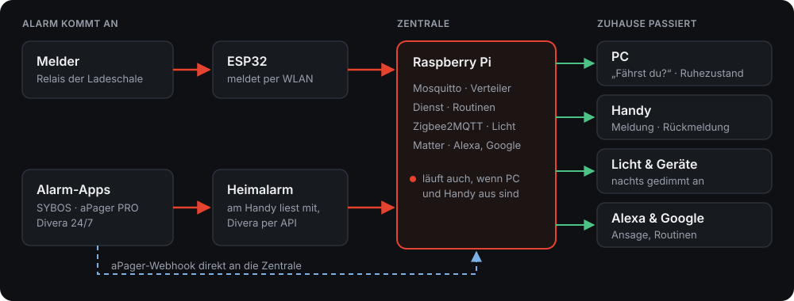
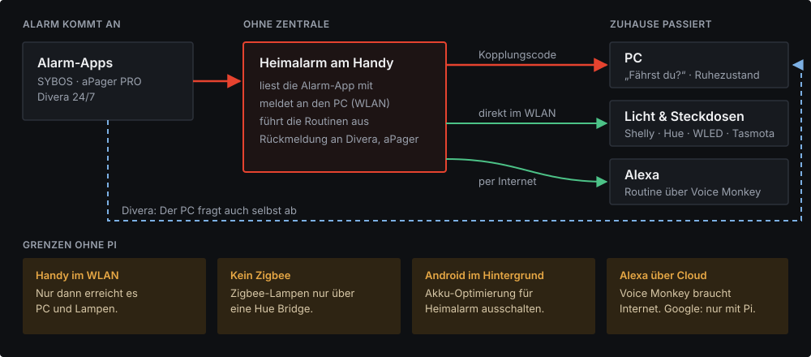

<p align="center"></p>

<h1 align="center">Heimalarm</h1>
<p align="center">Einsatz-Alarme zuhause weitergeben.</p>

---

## Was ist Heimalarm?

Heimalarm ist für Einsatzkräfte, die zuhause alarmiert werden – egal ob Feuerwehr, Rettungsdienst, Wasserwacht oder Katastrophenschutz. Wenn der Alarm kommt, reagiert das Zuhause mit:

- **PC:** Ein Vollbild fragt „Fährst du?“. Ohne Gegenrede geht der PC in den Ruhezustand – offene Programme bleiben erhalten.
- **Handy:** Meldung mit Stichwort und Adresse, Rückmeldung mit einem Tipp.
- **Licht & Sprachassistenten:** Nachts geht das Flurlicht gedimmt an, Alexa oder Google sagen „Einsatz!“ an.

Alles läuft lokal im Heimnetz, ohne Cloud und ohne laufende Kosten. Melder und Alarm-App bleiben die eigentliche Alarmierung – Heimalarm ist eine Komfortfunktion.

<p align="center">
  
  
</p>

## So funktioniert es

Heimalarm läuft auf zwei Arten – du wählst in der App unter *Einstellungen → Betrieb*.

**Mit Zentrale (Raspberry Pi)** – alles läuft auch, wenn PC und Handy aus sind.

<p align="center"></p>

**Ohne Zentrale** – Handy und PC arbeiten direkt zusammen. Ideal, wenn du nur auf SYBOS, aPager oder Divera wartest.

<p align="center"></p>

| | Mit Zentrale | Ohne Zentrale |
|---|---|---|
| PC herunterfahren | ✅ | ✅ Handy meldet an den PC, Divera fragt der PC selbst ab |
| Melder in der Ladeschale (ESP32) | ✅ | – |
| WLAN-Lampen & Steckdosen | ✅ | ✅ Handy schaltet direkt |
| Zigbee-Lampen | ✅ | nur über eine Hue Bridge |
| Alexa | ✅ Matter (lokal) oder Voice Monkey | ✅ Voice Monkey |
| Google Home | ✅ Matter (lokal) | – |
| Routinen | ✅ laufen auf dem Pi | ✅ laufen auf dem Handy |
| Läuft, wenn Handy aus oder unterwegs | ✅ | – |

## Funktionen

| | |
|---|---|
| **Alarmquellen** | Melder (ESP32), SYBOS, aPager PRO, Divera 24/7 – auch mehrere gleichzeitig. Doppelte Meldungen werden zu einem Einsatz. |
| **„Fährst du?“ am PC** | Vollbild mit Countdown und Ton. Danach Ruhezustand, Sperren, Herunterfahren oder nichts. Ausnahmen (z. B. bei laufendem OBS), Ruhezeiten, Medien stoppen. |
| **Rückmeldung** | „Ich fahre / nicht“ geht an Divera (Rückmeldung und Status) und aPager (Zu-/Absage). |
| **Divera-Status** | Eigenen Status in der Übersicht mit einem Tipp setzen, optional automatisch zurücksetzen. |
| **Licht & Geräte** | WLAN-Geräte (Shelly, Hue, WLED, Tasmota) direkt im Heimnetz, mit Zentrale auch Zigbee – ohne Hersteller-Cloud. |
| **Ohne Zentrale** | Handy und PC koppeln sich mit einem Code im WLAN. Das Handy meldet Alarme an den PC und führt die Routinen aus. |
| **Routinen** | Wenn Alarm, Uhrzeit oder Gerät → Licht, Gruppen, Verzögerung, „Wieder da“. Bedingungen wie Nacht, dunkel, Wochentag, Stichwort. Pro Person. |
| **Alexa & Google Home** | Alarm startet Routinen (Ansage, Licht). Lokal über Matter (mit Zentrale) oder Alexa über Voice Monkey (auch ohne). |
| **Mehrere Personen** | Jede Person mit eigener Kennung, eigenen Routinen und eigenem Melder. |
| **Übersicht** | Zeigt nur, was eingerichtet ist: Quellen, Zentrale, Melder, Geräte, letzte Einsätze. |
| **Test & Diagnose** | Testalarm, Kontakt simulieren, Komplettprobe, Verbindungstest, wöchentlicher Selbsttest. |
| **Sicher & privat** | Alles im Heimnetz. App-PIN, Admin-PIN, API-Schlüssel bleiben auf dem Gerät. |
| **Bedienung** | Dunkel (Standard) und hell, PC und Handy gleich, Einstellungen gleichen sich ab. |

## Kompatible Geräte

| Gerät | Ohne Zentrale | Mit Zentrale | Hinweis |
|---|---|---|---|
| **Shelly** (Schalter, Stecker, Dimmer) | ✅ | ✅ | direkt im WLAN, Gen1 bis Gen3 |
| **Philips Hue** | ✅ | ✅ | über die Hue Bridge; Knopf drücken zum Koppeln |
| **IKEA** (Tradfri, Dirigera-Lampen) | ✅ über Hue Bridge | ✅ | mit Zentrale direkt per Zigbee-Stick |
| **WLED** (LED-Streifen) | ✅ | ✅ | |
| **Tasmota** | ✅ | ✅ | umgeflashte Stecker und Lampen |
| **Tuya / Smart Life** | über Alexa-Routine | ✅ Zigbee-Geräte | WLAN-Geräte nur über die Tuya-Cloud – per Voice Monkey eine Alexa-Routine starten, die sie schaltet |
| **Zigbee allgemein** | – | ✅ | tausende Geräte, siehe [Zigbee2MQTT](https://www.zigbee2mqtt.io/supported-devices/) |
| **Amazon Echo** | ✅ Voice Monkey | ✅ Matter oder Voice Monkey | Echo mit Matter für den lokalen Weg |
| **Google Nest / Home** | – | ✅ Matter | Nest Hub, Nest Lautsprecher oder Google TV |

**Voice Monkey** ([voicemonkey.io](https://voicemonkey.io)) startet Alexa-Routinen per Internet. In Voice Monkey einen „Routine Trigger“ anlegen, in der Alexa-App eine Routine damit starten (z. B. Ansage „Einsatz!“, Licht an) und in Heimalarm den API-Token eintragen. In Routinen als Aktion „+ Alexa“.

## Installation & Einrichtung

**Was du brauchst:** Heimalarm auf PC (Windows) und/oder Handy (Android). Optional einen Raspberry Pi als Zentrale und einen ESP32 für den Melder.

**1 · App installieren**
Installer (`.exe`) bzw. APK aus den [Releases](../../releases) laden und installieren.

**2 · Betrieb wählen**
*Einstellungen → Betrieb:* „Mit Zentrale“ oder „Ohne Zentrale“. Ohne Zentrale am PC Adresse und Code ablesen und am Handy unter „PC hinzufügen“ eintragen. Windows fragt einmal nach der Firewall – „Private Netzwerke“ erlauben.

**3 · Alarmquellen wählen**
In der App unter *Einstellungen → Alarmquellen* einschalten, was du nutzt:
- **SYBOS / aPager / Divera:** Am Handy „Benachrichtigungen mitlesen“ erlauben. Für Divera bzw. aPager optional den persönlichen API-Schlüssel eintragen – dann klappt auch die Rückmeldung.
- **Melder:** braucht Zentrale und ESP32 (Schritt 5 und 6).

**4 · Licht & Alexa**
Unter *Geräte → WLAN-Geräte* Lampen und Steckdosen hinzufügen, unter *Einstellungen → Alexa & Google* den Voice-Monkey-Token eintragen. Dann unter *Routinen* „Vorlage“ antippen.

**5 · Zentrale (optional)** – Raspberry Pi mit Docker
```bash
cd zentrale
docker compose up -d                                     # Grundausstattung
docker compose --profile zigbee up -d                    # mit Zigbee-USB-Stick
docker compose --profile zigbee --profile matter up -d   # dazu Licht für Alexa / Google
```
Dann in der App unter *Einstellungen → Verbindung* die IP des Pi eintragen.

**6 · ESP32 (optional)**
1. `esp32/secrets.example.yaml` nach `secrets.yaml` kopieren und WLAN-Daten eintragen.
2. Kontakt der Ladeschale messen, dann Pol A an `GPIO27`, Pol B an `GND`.
3. `esp32/alarm-ich.yaml` über [web.esphome.io](https://web.esphome.io) flashen. Für ein **ESP32-S3**-Board stattdessen `esp32/alarm-ich-s3.yaml` nehmen – Pol A dann an `GPIO4`.

**7 · Testen**
*Einstellungen → Test & Diagnose → Testalarm.* Es passiert nichts Echtes, du siehst nur die Abfrage.

Ausführlich mit Bildern: [Konzept (PDF)](docs/Konzept.pdf)

---

<sub>Ergänzt die Alarmierung, ersetzt sie nicht. Melder und Alarm-App bleiben maßgeblich.</sub>
