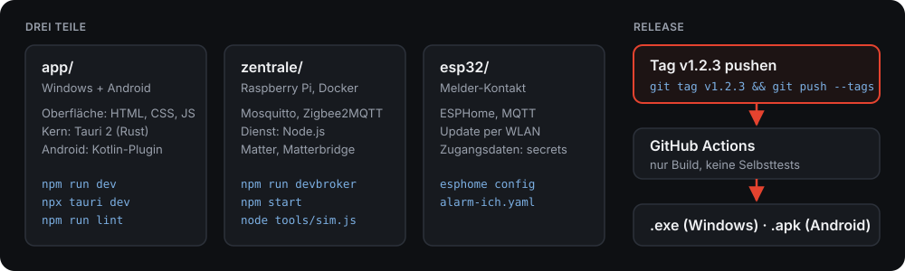

<p align="center"></p>

<h1 align="center">Heimalarm</h1>
<p align="center">Einsatz-Alarme zuhause weitergeben.</p>

---

## Was ist Heimalarm?

Heimalarm ist für Einsatzkräfte, die zuhause alarmiert werden – egal ob Feuerwehr, Rettungsdienst, Wasserwacht oder Katastrophenschutz. Wenn der Alarm kommt, reagiert das Zuhause mit:

- **PC:** Ein Vollbild fragt „Fährst du?“. Ohne Gegenrede geht der PC in den Ruhezustand – offene Programme bleiben erhalten.
- **Handy:** Meldung mit Stichwort und Adresse, Rückmeldung mit einem Tipp.
- **Licht & Sprachassistenten:** Nachts geht das Flurlicht gedimmt an, Alexa oder Google sagen „Einsatz!“ an.

Alles läuft lokal im Heimnetz, ohne Cloud und ohne laufende Kosten. Melder und Alarm-App bleiben die eigentliche Alarmierung – Heimalarm ist eine Komfortfunktion.

<p align="center">
  
  
</p>

## So funktioniert es

<p align="center"></p>

1. **Alarm kommt an** – über den Melder in der Ladeschale (ein ESP32 liest den Kontakt) und/oder über die Alarm-App am Handy.
2. **Die Zentrale** (Raspberry Pi) verteilt den Alarm und führt Routinen aus – auch wenn PC und Handy aus sind.
3. **Zuhause passiert**, was du eingestellt hast.

Ohne Zentrale geht es auch: Mit SYBOS, aPager oder Divera allein arbeitet die App direkt auf Handy und PC.

## Funktionen

| | |
|---|---|
| **Alarmquellen** | Melder (ESP32), SYBOS, aPager PRO, Divera 24/7 – auch mehrere gleichzeitig. Doppelte Meldungen werden zu einem Einsatz. |
| **„Fährst du?“ am PC** | Vollbild mit Countdown und Ton. Danach Ruhezustand, Sperren, Herunterfahren oder nichts. Ausnahmen (z. B. bei laufendem OBS), Ruhezeiten, Medien stoppen. |
| **Rückmeldung** | „Ich fahre / nicht“ geht an Divera (Rückmeldung und Status) und aPager (Zu-/Absage). |
| **Divera-Status** | Eigenen Status in der Übersicht mit einem Tipp setzen, optional automatisch zurücksetzen. |
| **Licht & Geräte** | Zigbee-Geräte anlernen und steuern, ohne Hersteller-Cloud. |
| **Routinen** | Wenn Alarm, Uhrzeit oder Gerät → Licht, Gruppen, Verzögerung, „Wieder da“. Bedingungen wie Nacht, dunkel, Wochentag, Stichwort. Pro Person. |
| **Alexa & Google Home** | Alarm startet Routinen (Ansage, Licht). Zigbee-Licht per Sprache. Lokal über Matter. |
| **Mehrere Personen** | Jede Person mit eigener Kennung, eigenen Routinen und eigenem Melder. |
| **Übersicht** | Zeigt nur, was eingerichtet ist: Quellen, Zentrale, Melder, Geräte, letzte Einsätze. |
| **Test & Diagnose** | Testalarm, Kontakt simulieren, Komplettprobe, Verbindungstest, wöchentlicher Selbsttest. |
| **Sicher & privat** | Alles im Heimnetz. App-PIN, Admin-PIN, API-Schlüssel bleiben auf dem Gerät. |
| **Bedienung** | Dunkel (Standard) und hell, PC und Handy gleich, Einstellungen gleichen sich ab. |

## Installation & Einrichtung

**Was du brauchst:** Heimalarm auf PC (Windows) und/oder Handy (Android). Für Melder, Licht und Sprachassistenten zusätzlich einen Raspberry Pi und einen ESP32.

**1 · App installieren**
Installer (`.exe`) bzw. APK aus den [Releases](../../releases) laden und installieren.

**2 · Alarmquellen wählen**
In der App unter *Einstellungen → Alarmquellen* einschalten, was du nutzt:
- **SYBOS / aPager / Divera:** Am Handy „Benachrichtigungen mitlesen“ erlauben. Für Divera bzw. aPager optional den persönlichen API-Schlüssel eintragen – dann klappt auch die Rückmeldung.
- **Melder:** braucht Zentrale und ESP32 (Schritt 3 und 4).

**3 · Zentrale (optional)** – Raspberry Pi mit Docker
```bash
cd zentrale
docker compose up -d                                     # Grundausstattung
docker compose --profile zigbee up -d                    # mit Zigbee-USB-Stick
docker compose --profile zigbee --profile matter up -d   # dazu Licht für Alexa / Google
```
Dann in der App unter *Einstellungen → Verbindung* die IP des Pi eintragen.

**4 · ESP32 (optional)**
1. `esp32/secrets.example.yaml` nach `secrets.yaml` kopieren und WLAN-Daten eintragen.
2. Kontakt der Ladeschale messen, dann Pol A an `GPIO27`, Pol B an `GND`.
3. `esp32/alarm-ich.yaml` über [web.esphome.io](https://web.esphome.io) flashen.

**5 · Testen**
*Einstellungen → Test & Diagnose → Testalarm.* Es passiert nichts Echtes, du siehst nur die Abfrage.

Ausführlich mit Bildern: [Konzept (PDF)](docs/Konzept.pdf)

## Entwickeln

<p align="center"></p>

**App** (`app/`) – Oberfläche in HTML, CSS und JavaScript, Kern in Tauri 2 (Rust), Android-Teile als Kotlin-Plugin.
```bash
cd app && npm install
npm run dev          # Oberfläche im Browser, ?demo zeigt Beispieldaten
npx tauri dev        # als Windows-Programm
npm run lint         # Oxlint
```

**Zentrale ohne Hardware testen** (`zentrale/dienst/`) – Test-Broker und Simulator für ESP32 und Zigbee-Geräte.
```bash
cd zentrale/dienst && npm install
npm run devbroker                              # Terminal 1
MQTT_URL=mqtt://127.0.0.1:1883 npm start       # Terminal 2
node tools/sim.js                              # Terminal 3
```

**Release** – Tag pushen, GitHub Actions baut `.exe` und `.apk`. Nur Build, keine Selbsttests – damit Bugfix-Releases schnell gehen.
```bash
git tag v0.2.0 && git push --tags
```

Regeln, Topics und Aufbau im Detail: [Context.md](Context.md)

---

<sub>Ergänzt die Alarmierung, ersetzt sie nicht. Melder und Alarm-App bleiben maßgeblich.</sub>
